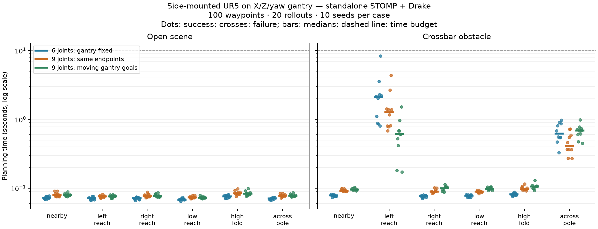

# STOMP with a sideways UR5 on an X/Z/yaw gantry

The confirmed model has **nine actuated joints**: world-X translation,
world-Z translation, world-Z yaw, followed by the UR5's six revolute joints.
The UR5 base's +Z axis is rotated to point along torso +X. At zero yaw this
is world +X; rotating the torso also rotates that arm mounting axis.

The benchmark uses the standalone ROS-Industrial STOMP C++ core with Drake
kinematics and collision queries. No ROS nodes or MoveIt pipeline are involved.

## Geometry and limits

| Parameter | Value |
|---|---|
| X total travel | 2 m, represented as −1 to +1 m |
| Z total travel | 0.70 m, represented as 0 to 0.70 m |
| Yaw | −180° to +180° |
| Mount height before Z extension | 0.60 m (assumed, not supplied) |
| Initial gantry configuration | X = 0 m, Z = 0.35 m, yaw = 0° |
| Initial arm base world position | (0, 0, 0.95) m |
| Torso collision shape | 0.18 × 0.28 × 0.40 m box |
| Torso box center relative to mount | (−0.16, 0, −0.10) m |

Torso size and placement are surrogate assumptions. This is not a CAD model of
the actual gantry: it omits rails, supporting columns, floor, gripper, cables
and payload. Those could materially change collision checks and planning.
The translational axes are fixed in the world; yaw is downstream of both slides.

Both scenes include robot self-collision and the torso. The obstacle scene adds
a box of size 0.80 × 0.12 × 0.12 m centered at (0.40, 0.50, 0.95) m. This crossbar
is the previous experiment's pole transformed with the arm's nominal mounting
frame, preserving the arm-relative obstruction for the comparison. Target
`across_pole` retains its old name in data files, although the obstacle is now
a horizontal crossbar.

## Controlled comparison

Three modes use the same physical nine-joint model and collision geometry:

1. **locked6:** optimize the six arm joints; fix all gantry coordinates throughout.
2. **free9:** optimize all nine joints with exactly the same full start and goal
   as locked6. Gantry motion is permitted during the path, but it returns to
   its initial configuration at the goal. This is the direct comparison of
   adding planning dimensions and redundancy.
3. **moving9:** optimize all nine joints with new endpoints that translate and
   rotate the gantry. This is a broader motion test, not an identical-goal comparison.

There are six target poses, two scenes, three modes and ten seeds (0–9):
**360 trials**. STOMP uses 100 waypoints, 20 rollouts per iteration, at most
500 iterations and a soft 10-second budget. It stops at its first valid
post-iteration solution. All 360 trials succeeded and passed the final checks;
there were no rejected endpoints or timeouts.

## Measured planning times

Means include all trials. Open-scene rows aggregate six targets × ten seeds;
each obstacle row has ten seeds. Times are in seconds.

| Planning mode | Open scene mean | Left reach around crossbar mean | Across crossbar mean |
|---|---:|---:|---:|
| Six optimized joints, gantry fixed | 0.072 | 2.427 | 0.670 |
| Nine optimized joints, same endpoints | 0.079 | 1.550 | 0.468 |
| Nine optimized joints, moving gantry goals | 0.079 | 0.638 | 0.674 |

| Planning mode | Left reach median / maximum | Across crossbar median / maximum |
|---|---:|---:|
| Gantry fixed | 2.097 / 8.334 | 0.621 / 0.978 |
| Nine joints, same endpoints | 1.278 / 4.388 | 0.414 / 0.727 |
| Nine joints, moving goals | 0.614 / 1.518 | 0.692 / 0.986 |

Enabling nine-joint planning raised the easy open-scene mean by approximately
**10%**. For the same-endpoint obstacle tasks, mean iterations fell from
32.1 to 17.3 for left reach, and from 8.4 to 5.0 for crossing the obstacle.
The saved paths show that the optimizer uses the gantry slides and yaw to
avoid the obstacle. The extra freedom helps convergence in these examples.
There is no demonstrated dramatic slowdown from the additional prismatic joints.
This does not establish a universal improvement or runtime bound.

Final path validation is timed separately: it averaged 0.0045 s in locked6,
0.0049 s in free9 and 0.0058 s in moving9. All runs were sequential on the same
AMD Ryzen 7 5700X desktop in its existing Drake container (Drake 1.55.0).
The machine was not isolated for hard real-time benchmarking.



## Why prismatic joints work

STOMP optimizes numerical joint coordinates through a supplied task/cost
interface; it is not restricted to revolute joints. The adapter now accepts
an arbitrary number of planning dimensions. The original six-joint ABI is
preserved and its seeded output was regression-checked.

Mixing metres and radians requires explicit scaling. This experiment uses
characteristic scales of **0.25 m per prismatic coordinate and 1 rad per
rotational coordinate**, then:

- Samples noise at 0.15 m for X/Z and 0.6 rad for each rotation.
- Applies the smoothness cost to normalized coordinates `q / scale`.
- Uses the same normalized distance for interpolated collision checking.
- Enforces each joint's own limits and preserves the endpoints.

These values are declared tuning choices, not universal STOMP parameters.
Using the same raw numerical noise for metres and radians would give a
different exploration distribution. Travel limits, obstacles, initialization,
rollout count and scaling can matter more than the joint-type label.

With 100 waypoints and fixed endpoints, the optimized interior coordinates
increase from 6 × 98 = 588 to 9 × 98 = 882. The temporal covariance matrix
still has 98 × 98 entries per joint; adding three joints does not turn it into
an 882 × 882 dense covariance inversion in this implementation.

## Goals and scope

The six arm targets retain the earlier experiment's joint configurations.
For moving9, the gantry endpoint settings are:

| Target | X (m) | Z extension (m) | Yaw (degrees) |
|---|---:|---:|---:|
| nearby | 0.15 | 0.4025 | 10 |
| left_reach | −0.60 | 0.5250 | −25 |
| right_reach | 0.60 | 0.2450 | 25 |
| low_reach | 0.40 | 0.1750 | 15 |
| high_fold | −0.40 | 0.5950 | −20 |
| across_pole | 0.50 | 0.4900 | 40 |

All full joint endpoints and resulting Cartesian poses are saved in
`gantry_xz_2m_070m/metadata.json`. These are known joint solutions, so times
exclude IK and selecting among redundant end-effector pose solutions. They
also exclude execution, dynamic feasibility and time parameterization.

Drake uses convex hulls of the imported UR5 collision meshes. Final validation
samples path segments with at most 0.025 normalized joint-space increments
(at most 6.25 mm in either slide and 0.025 rad in any rotational coordinate).
It is a discrete test, not a continuous collision-freedom guarantee. The
optimizer requires 2 mm clearance at its waypoints; the final sampled edge
test checks for collision with zero padding. No velocity, acceleration,
torque, balance or structural constraints are imposed.

Ten seeds per case do not establish tail-latency or rare-failure guarantees.
The earlier placeholder-dimension run was archived under `smoke/gantry_placeholder`;
the results in this document use the user's confirmed 2 m / 70 cm / ±180° limits.

## Reproduce and inspect

Inside the existing `lunar-rover-jazzy-drake` container:

```sh
cd ~/drake/stomp_benchmark
# Rebuild only if the bridge is missing or changed:
python setup.py

# Choose a fresh output directory; completed runs are protected from overwrite.
OPENBLAS_NUM_THREADS=1 OMP_NUM_THREADS=1 python gantry_benchmark.py \
  --config gantry_xz.json --output gantry_rerun
python verify_gantry.py gantry_rerun
python gantry_plot.py gantry_rerun
python gantry_view.py gantry_rerun/bar_free9_left_reach_0.npy
```

The HTML viewer is standalone. Green shows the optimized tool path, red the
initial tool path, and blue the moving arm-mount path. Playback duration is
five seconds for illustration, not a validated robot execution schedule.

Current artifacts:

- [Raw trial data](gantry_xz_2m_070m/trials.csv)
- [Per-pose statistics](gantry_xz_2m_070m/summary.json)
- [Configuration and goal poses](gantry_xz_2m_070m/metadata.json)
- [Same-endpoint gantry motion animation](gantry_xz_2m_070m/bar_free9_left_reach_0.html)
- [Moving-goal gantry animation](gantry_xz_2m_070m/bar_moving9_across_pole_0.html)

`verify_gantry.py` checks the mounting axis, both slide directions, yaw direction,
200 random configuration comparisons between distance queries and the collision
checker, and all saved paths' dimensions, finite values, endpoints, limits and
fixed-gantry invariants. Each benchmark trial independently validates its path.

Sources: [STOMP core and task interface](https://github.com/ros-industrial/stomp),
[Drake prismatic joint](https://drake.mit.edu/doxygen_cxx/classdrake_1_1multibody_1_1_prismatic_joint.html).
